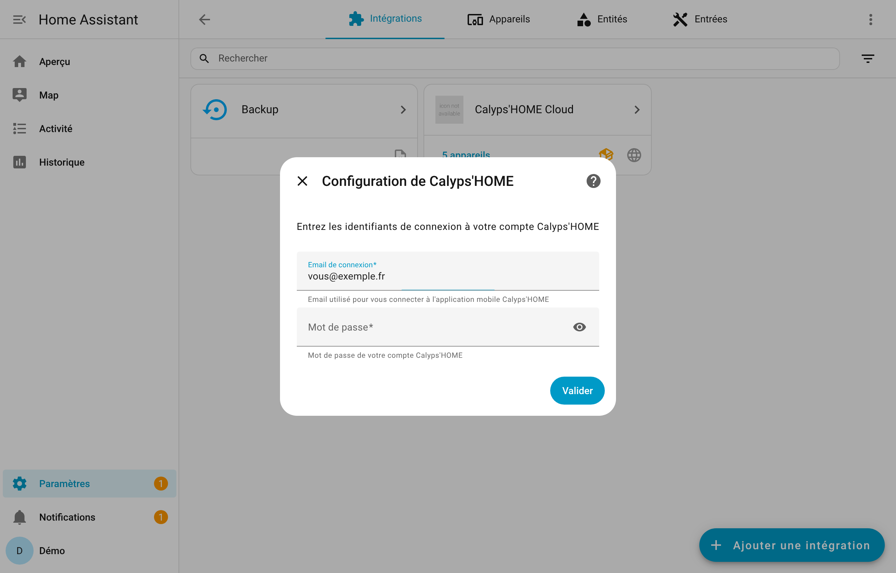
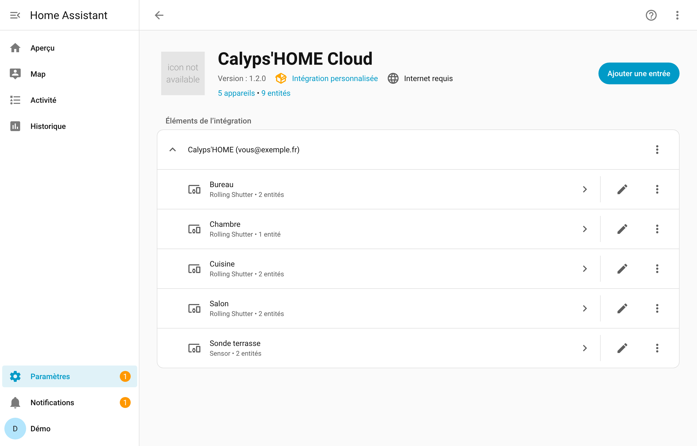
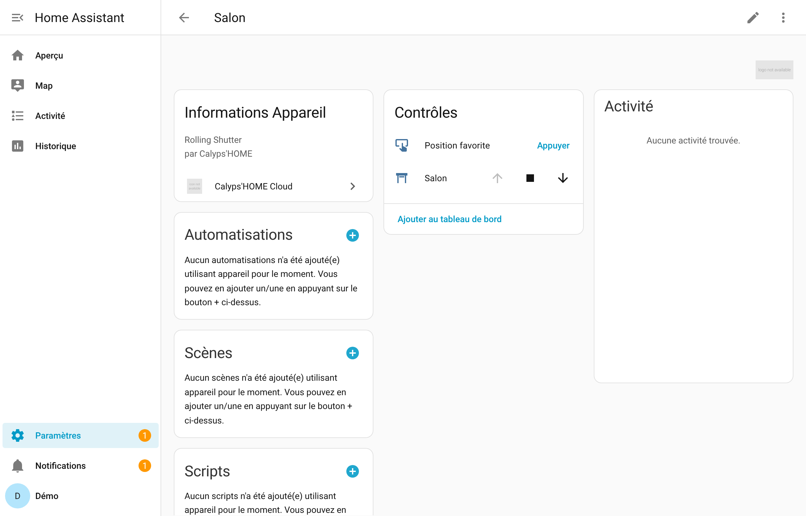
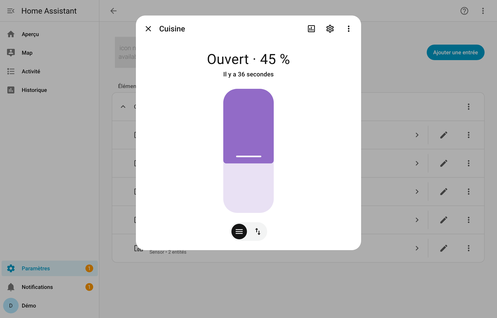
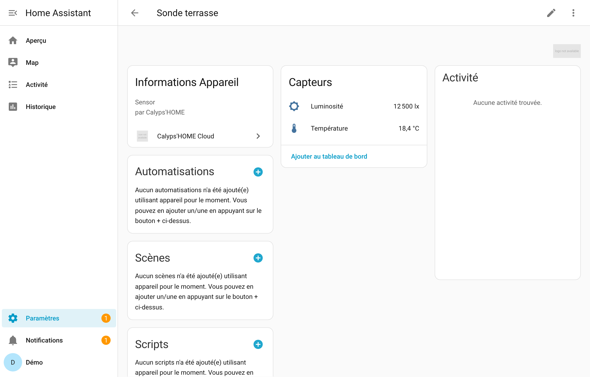

# Calyps'HOME - Intégration Home Assistant (Cloud)

[](https://github.com/Legobis965/hass-calypshome-cloud/actions/workflows/validate.yml)
[](https://hacs.xyz/)
[](https://www.home-assistant.io/)

Intégration personnalisée pour contrôler vos volets roulants Calyps'HOME et lire vos sondes (température, luminosité) via Home Assistant et le cloud Calyps'HOME.

## ⚠️ Avertissement / Disclaimer

**Ce composant personnalisé est indépendant et n'est en aucun cas affilié à la marque Calyps'HOME.**

- ✋ **Projet non officiel** : Ce composant a été développé de manière indépendante et n'est pas supporté par le fabricant Calyps'HOME
- 🚫 **Aucune garantie** : Ce logiciel est fourni "tel quel", sans aucune garantie de fonctionnement
- ⚠️ **Utilisation à vos risques** : L'auteur ne peut être tenu responsable de tout dysfonctionnement, dommage matériel ou perte de données résultant de l'utilisation de ce composant
- 🔧 **Support limité** : Le support technique est fourni sur la base du volontariat et sans engagement
- 📝 **Licence MIT** : Ce projet est fourni sous licence MIT - voir le fichier LICENSE pour plus de détails

**En utilisant ce composant, vous acceptez ces conditions.**

## Origine du projet

Ce dépôt est un fork du projet original [saniho/calypshome](https://github.com/saniho/calypshome).

Le projet original fonctionnait **en mode local uniquement** : il communiquait directement avec la box Calyps'HOME sur le réseau local.

Ce fork a été réécrit pour basculer vers un **fonctionnement entièrement cloud** : l'intégration communique désormais avec l'API cloud d'Avidsen (`calypshome.avidsen.one`) exactement comme le fait l'application mobile officielle. Cela permet d'utiliser l'intégration depuis n'importe où, sans dépendance au réseau local.

Merci à l'auteur original pour le travail de base et les idées initiales.

## Fonctionnalités

- ✅ Découverte automatique de tous les volets roulants
- ✅ Découverte automatique des sondes (température et luminosité)
- ✅ Ouverture / Fermeture / Arrêt
- ✅ Positionnement précis (0-100 %), exécuté par le moteur du volet
- ✅ Position **réelle** remontée par le cloud (pas d'estimation par minuterie)
- ✅ Mise à jour en temps réel via WebSocket (volets, température, luminosité)
- ✅ Bouton **Position favorite** pour les volets qui la supportent
- ✅ Les objets **masqués** dans l'application Calyps'HOME ne sont pas importés
- ✅ Noms d'entités traduits (français / anglais) et regroupés par appareil
- ✅ Configuration via l'interface utilisateur, avec détection des comptes en double
- ✅ Réauthentification et changement d'email ou de mot de passe sans supprimer l'intégration
- ✅ Entités indisponibles quand le cloud ne répond pas, nouvel essai automatique au démarrage
- ✅ Fonctionne depuis n'importe quel réseau (cloud)

## Captures d'écran

> Captures réalisées dans Home Assistant 2026.2 avec des données d'exemple.

**Ajout de l'intégration** — seuls l'email et le mot de passe de l'application Calyps'HOME sont demandés :

<p align="center">
  
</p>

**Appareils découverts** — un appareil par volet et par sonde :

<p align="center">
  
</p>

**Fiche d'un volet** — commandes ouverture / arrêt / fermeture et bouton de position favorite :

<p align="center">
  
</p>

**Position réelle d'un volet** — curseur de position alimenté par le niveau renvoyé par le cloud :

<p align="center">
  
</p>

**Fiche d'une sonde** — température et luminosité :

<p align="center">
  
</p>

## Prérequis

- Home Assistant **2024.11** ou plus récent
- Un compte Calyps'HOME (identifiants de l'application mobile)

## Installation

### Méthode 1 : Installation via HACS

1. Ajoutez ce dépôt comme dépôt personnalisé dans HACS (catégorie : Integration)
2. Installez l'intégration Calyps'HOME
3. Redémarrez Home Assistant
4. Allez dans **Paramètres** → **Appareils et services**
5. Cliquez sur **+ Ajouter une intégration**
6. Recherchez "Calyps'HOME"
7. Entrez vos informations de connexion :
   - **Email** : Votre email de connexion au cloud Calyps'HOME
   - **Mot de passe** : Votre mot de passe

### Méthode 2 : Installation manuelle

1. Copiez le dossier `custom_components/calypshome_cloud` dans votre dossier `config/custom_components/` de Home Assistant
2. Redémarrez Home Assistant
3. Allez dans **Paramètres** → **Appareils et services**
4. Cliquez sur **+ Ajouter une intégration**
5. Recherchez "Calyps'HOME"
6. Entrez vos identifiants de connexion au cloud Calyps'HOME

## Configuration

Après l'installation, vos volets roulants et vos sondes sont automatiquement découverts : un appareil est créé pour chacun, avec ses entités (`cover`, `button`, `sensor`, voir [Entités créées](#entités-créées)).

### Changer d'email ou de mot de passe

- **Mot de passe modifié ou refusé** : Home Assistant affiche une notification *« Réauthentification requise »*. Cliquez dessus et saisissez le nouveau mot de passe, ou un autre email si le compte a changé.
- **À tout moment** : **Paramètres** → **Appareils et services** → **Calyps'HOME Cloud** → menu ⋮ de l'entrée → **Reconfigurer**.

Dans les deux cas, les entités et leur historique sont conservés. Un email déjà utilisé par une autre entrée est refusé.

## Utilisation

### Dans l'interface Lovelace

Les volets apparaîtront automatiquement dans votre interface avec les contrôles standard :
- Bouton Ouvrir
- Bouton Fermer
- Bouton Stop
- Curseur de position

### Dans les automatisations

```yaml
# Exemple : Fermer tous les volets au coucher du soleil
automation:
  - alias: "Fermer volets au coucher du soleil"
    trigger:
      platform: sun
      event: sunset
    action:
      - service: cover.close_cover
        target:
          entity_id: all
```

### Dans les scripts

```yaml
# Exemple : Ouvrir la cuisine à 50%
script:
  cuisine_mi_ouvert:
    sequence:
      - service: cover.set_cover_position
        target:
          entity_id: cover.cuisine
        data:
          position: 50
```

### Via les services

```yaml
# Ouvrir un volet (remplacez par le nom de votre volet)
service: cover.open_cover
target:
  entity_id: cover.votre_volet

# Fermer un volet
service: cover.close_cover
target:
  entity_id: cover.votre_volet

# Position spécifique (0 = fermé, 100 = ouvert)
service: cover.set_cover_position
target:
  entity_id: cover.votre_volet
data:
  position: 75

# Arrêter un volet en mouvement
service: cover.stop_cover
target:
  entity_id: cover.votre_volet
```

## Entités créées

Les noms sont composés à partir du nom de l'appareil et traduits selon la langue de Home Assistant (exemples en français ci-dessous).

| Entité | Type | Créée pour | Description |
|---|---|---|---|
| `<volet>` | `cover` | chaque volet | État (ouvert, fermé, en ouverture, en fermeture) et position 0-100 % |
| `<volet> Position favorite` | `button` | chaque volet supportant l'action `FAV_CALL_1` | Envoie le volet à la position favorite mémorisée dans son moteur |
| `<sonde> Température` | `sensor` | chaque sonde avec une mesure de température | Température en °C |
| `<sonde> Luminosité` | `sensor` | chaque sonde avec une mesure de luminosité | Éclairement en lx |

Les objets masqués dans l'application Calyps'HOME ne sont pas importés.

> Les entités créées par une version précédente gardent leur identifiant (`entity_id`) : vos automatisations continuent de fonctionner.

## Dépannage

### Les volets ne sont pas découverts

1. Vérifiez vos identifiants de connexion au cloud
2. Consultez les logs : **Paramètres** → **Journaux** → Recherchez "calypshome_cloud"
3. Vérifiez que votre compte Calyps'HOME contient bien des volets
4. Vérifiez que le volet n'est pas **masqué** dans l'application Calyps'HOME : les objets masqués sont ignorés

### Les entités sont « indisponibles »

Le cloud Calyps'HOME ne répond pas. L'intégration réessaie automatiquement toutes les 5 minutes ; les entités redeviennent disponibles dès que le cloud répond.

### Un volet reste « en ouverture » ou « en fermeture »

Sans nouvelle position pendant 90 secondes, le mouvement est considéré comme terminé. Si vos volets mettent plus longtemps, augmentez `MOTION_TIMEOUT` dans `cover.py`.

### Les commandes ne fonctionnent pas

1. Vérifiez que vos commandes fonctionnent sur l'interface ou l'application d'origine
2. Vérifiez les logs Home Assistant
3. Assurez-vous que votre compte cloud est valide

### Logs

Pour activer les logs détaillés, ajoutez dans `configuration.yaml` :

```yaml
logger:
  default: info
  logs:
    custom_components.calypshome_cloud: debug
```

## Développement

Ce composant a été développé en analysant le trafic HTTP de l'application mobile officielle Calyps'HOME afin de reproduire fidèlement les appels vers l'API cloud Avidsen.

### Intégration continue

À chaque push et chaque semaine, GitHub Actions valide l'intégration avec :
- **hassfest** : validation officielle Home Assistant (manifest, traductions, config flow) ;
- **HACS** : validation du dépôt pour HACS.

### Publier une version

1. Mettre à jour `version` dans `custom_components/calypshome_cloud/manifest.json` (ex. `1.2.0`).
2. Créer et pousser le tag correspondant :
   ```bash
   git tag 1.2.0
   git push origin 1.2.0
   ```
3. Le workflow **Release** vérifie que le tag correspond au manifest, puis publie la release GitHub avec les notes générées et l'archive `calypshome_cloud.zip`.

## À propos de ce projet

Ce composant est un projet **communautaire non officiel** créé pour permettre l'intégration des volets roulants Calyps'HOME dans Home Assistant via le cloud.

**Relation avec la marque** :
- ❌ Non développé par Calyps'HOME
- ❌ Non validé par Calyps'HOME
- ❌ Non supporté officiellement par Calyps'HOME
- ✅ Développé par la communauté pour la communauté

**Crédits** :
- Projet original (mode local) : [saniho/calypshome](https://github.com/saniho/calypshome)
- Ce fork : réécriture complète en mode cloud

**Responsabilités** :
- L'auteur de ce composant n'est pas responsable des dysfonctionnements de votre installation
- Calyps'HOME n'est pas responsable des problèmes liés à l'utilisation de ce composant
- Toute modification de la configuration de votre compte se fait sous votre responsabilité

## Licence

MIT License - Ce logiciel est fourni sans aucune garantie.

## Support

Pour toute question ou problème :
- 📖 Consultez d'abord la documentation
- 🔍 Vérifiez les issues existantes sur GitHub
- 💬 Ouvrez une nouvelle issue si nécessaire

**Note** : Pour les problèmes matériels ou liés au service Calyps'HOME lui-même, contactez directement le support officiel de Calyps'HOME.